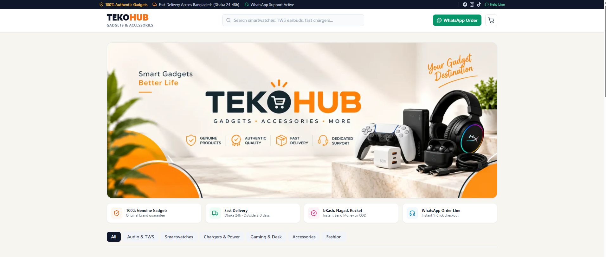
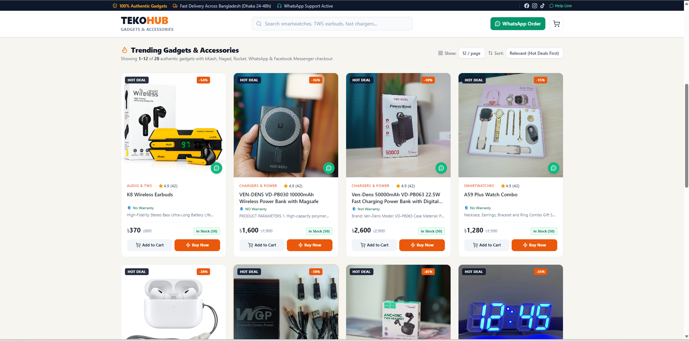
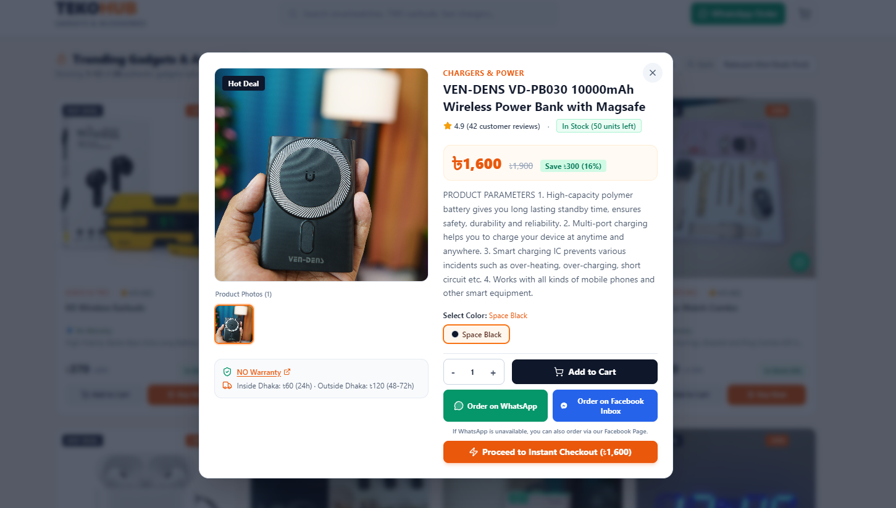
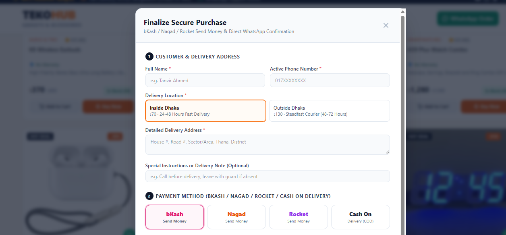

# TEKOHUB – Smart Gadgets · Better Life

**A Modern Gadget & Accessories E-commerce Platform**

🌐 [Visit Live Website](https://tekohub-xi.vercel.app/)

## About the Project

**TekoHub** is a modern e-commerce platform designed to showcase and sell gadgets and electronic accessories online.

The platform provides a user-friendly shopping experience with product browsing, product details, cart management, and an order placement interface.

## Live Demo

🌐 **Website:** [https://tekohub-xi.vercel.app/](https://tekohub-xi.vercel.app/)

## Key Features

- Modern and responsive e-commerce interface
- Product listing and product details
- Shopping cart functionality
- Checkout interface
- Order confirmation interface
- Admin login interface
- Product management interface
- Firebase integration
- WhatsApp contact integration

## Technology Stack


- **Frontend:** React.js, TypeScript
- **Build Tool:** Vite
- **Backend Services:** Firebase
- **Database:** Cloud Firestore
- **Deployment:** Vercel
- **Styling:** CSS


## Project Structure

```text
TEKOHUB/
├── public/
├── src/
│   ├── components/
│   ├── data/
│   ├── lib/
│   ├── types/
│   ├── utils/
│   ├── App.tsx
│   ├── index.css
│   └── main.tsx
├── package.json
└── vite.config.ts
```

## Project Highlights

- Component-based React architecture
- TypeScript for structured development
- Firebase services integration
- Reusable UI components
- Vercel deployment

## Screenshots

*Add screenshots of the homepage, product listing, product details, and checkout interface here.*

## Future Improvements

- Enhanced admin dashboard
- Improved order management
- Advanced product filtering and search
- Better analytics and reporting
- Additional payment integration

## Developer

**Maruf Khan**

GitHub: [@Marufkhan980](https://github.com/Marufkhan980)

## Screenshots

### Homepage



### Product Listing



### Product Details



### Checkout Page



---

---

**TEKOHUB – Smart Gadgets · Better Life**

Developed by Maruf Khan
